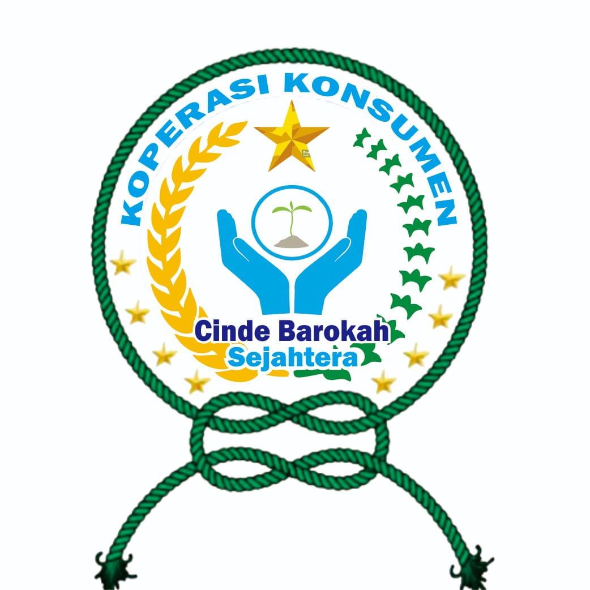

<p align="center">
  
  
</p>

<h1 align="center">BMT Cinde Barokah — Aplikasi Penjualan</h1>

<p align="center">Aplikasi pencatatan pembelian, penjualan, stok, dan laporan laba rugi berbasis Laravel 10 + Blade.</p>

## Fitur

- Dashboard ringkasan transaksi dengan grafik penjualan dan pembelian.
- Pembelian otomatis menambah stok dan mendaftarkan barang baru.
- Stok dipisahkan per pemilik (Master ID Nama).
- Penjualan dengan validasi stok dan perhitungan total otomatis.
- Filter tanggal, pencarian, dan ekspor CSV/Excel/PDF.
- Laporan laba rugi dari selisih harga beli dan harga jual.
- Login, kelola akun, dan pembuatan akun admin via CLI.

## Teknologi

- PHP 8.1 · Laravel 10 · MySQL/MariaDB · Composer

## Instalasi

```bash
cp .env.example .env
composer install
php artisan key:generate
php artisan migrate
php artisan app:create-admin
php artisan serve --port=8108
```

Atur kredensial database di `.env` sebelum `migrate`. Buka <http://127.0.0.1:8108>, lalu login di `/login`.

## Pengujian

```bash
php artisan test
```

Tes memakai database terpisah `aplikasi_penjualan_testing` (lihat `phpunit.xml`).

## Catatan

Laravel 10 sudah melewati masa dukungan keamanan — tinjau risikonya sebelum dipakai di produksi.
